# 🦎 Ajolotito hambriento: notificaciones locales con TDD

**Actividad 14. Notificaciones** · Desarrollo de Aplicaciones Móviles · UTNG  
Prof. Anastacio Rodríguez García

Un ajolote cuya saciedad baja con el tiempo y que **avisa con notificaciones locales** cuando tiene hambre. La lógica está aislada del plugin `flutter_local_notifications` con *puertos y adaptadores*, así que todo se prueba con un reloj falso y un puerto falso, siguiendo el ciclo **🔴 Rojo → 🟢 Verde → 🔵 Refactor**.

## Cómo ejecutar

```bash
flutter pub get
flutter test -r expanded   # todas las pruebas
flutter run                # la app en el emulador
```

## Arquitectura

```
lib/
  dominio/      reloj · mascota · categoria · mensajes · politica · payload · planificador
                puerto · almacen · gestor_permiso · servicio
  infra/        puerto_real (único archivo que conoce el plugin) · almacen_prefs
  presentacion/ ajolote_vm · dibujo_ajolote · pantalla_ajolote · pantalla_ajustes
  app.dart · main.dart
test/           mascota · politica_payload · planificador · permiso · servicio · vm · pantalla (+ falsos.dart)
integration_test/capturas_test.dart   recorrido en el emulador con capturas
```

| Regla | Cómo se cumple |
|---|---|
| Nada de madrugadas | Silencio de 22:00 a 08:00: el aviso se **mueve**, no se pierde |
| Sin spam | Máximo 3 avisos al día y colapso de avisos casi juntos |
| Sin duplicados | Ids fijos (1, 2, 100-102): programar con el mismo id reemplaza |
| Permiso en contexto | Explicación propia con "Ahora no" antes del diálogo del sistema |
| El usuario manda | Dos canales (hambre y sorpresas) que se apagan por separado |
| Payload seguro | `v1:destino`; si llega basura, abre en el inicio |

---

## Pruebas por fase (ejecutadas en el cmd)

Cada fase se ejecutó en la terminal de Windows con `flutter test -r expanded`. En la fase **roja** la prueba corre con el código de producción vacío (`// TODO: falta implementar`) y falla; en la **verde** corre con el código implementado y pasa.

### Fase 1. El ajolote y su saciedad (`test/mascota_test.dart`)

Saciedad que baja 10 puntos por hora, humor con pruebas de frontera (justo en 40 y en 15), predicción de cuándo tendrá hambre, alimentar, cambio de ritmo sin saltos y lectura desconfiada del JSON guardado.

**🔴 Fase roja**

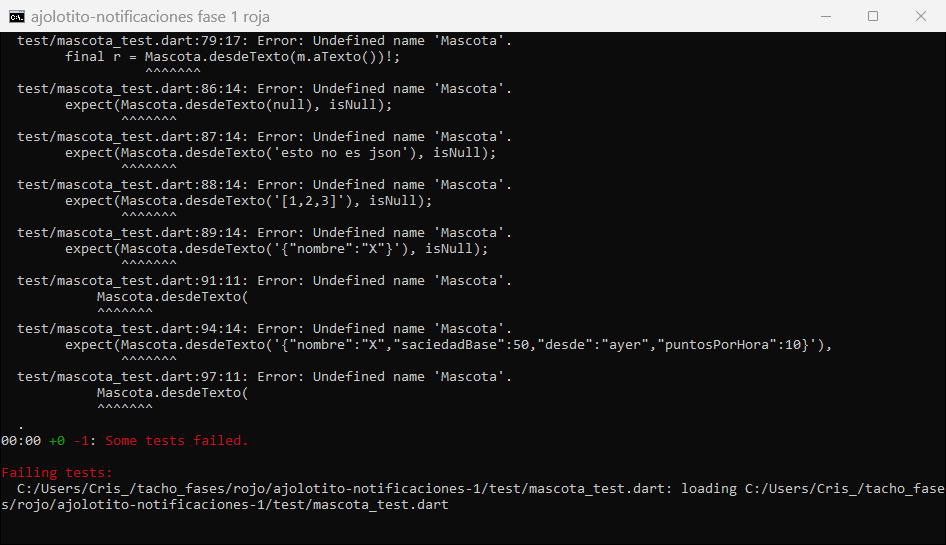

**🟢 Fase verde**

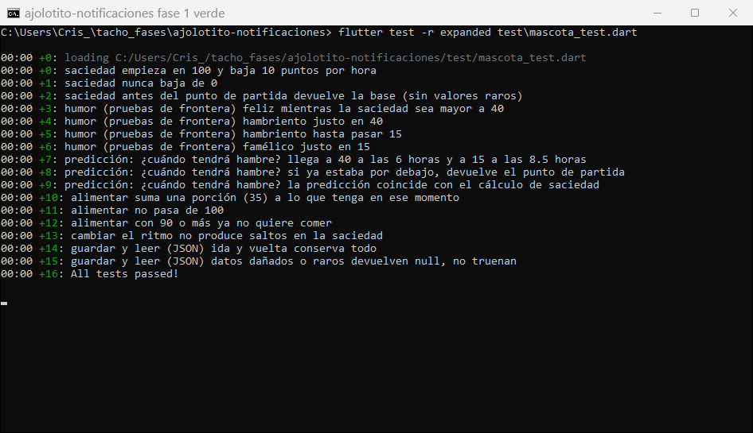

### Fase 2. Política de buena educación y payload (`test/politica_payload_test.dart`)

Horas de silencio que cruzan la medianoche (22:00 a 08:00), mover el aviso al final del silencio (incluso en fin de mes) y un payload versionado (`v1:alimentar`) que nunca truena con basura.

**🔴 Fase roja**

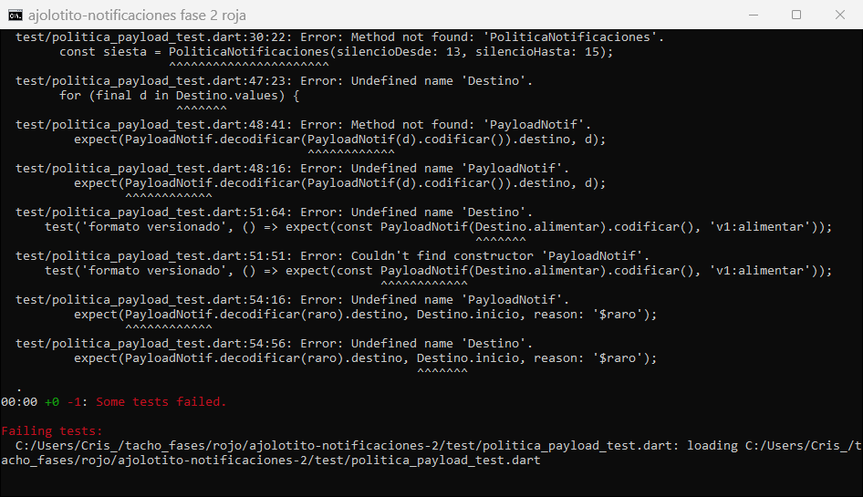

**🟢 Fase verde**

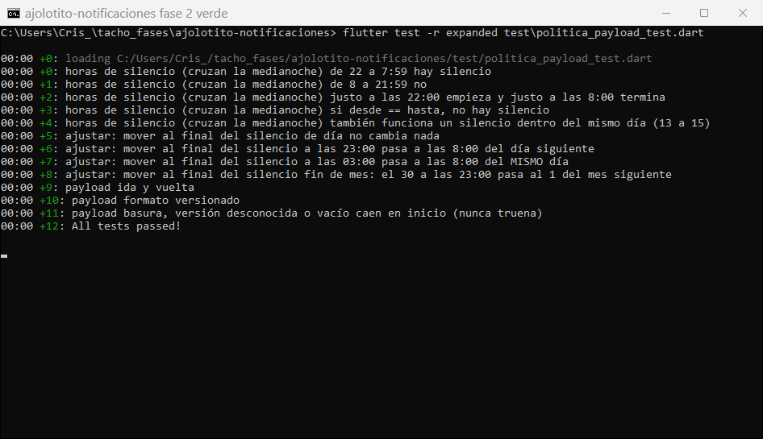

### Fase 3. El planificador de avisos (`test/planificador_test.dart`)

Del estado del ajolote a la agenda: hambre 16:00, sorpresa 18:00, crítico 18:30; nada en horas de silencio (se revisan las 24 horas), colapso de avisos casi juntos, categorías apagadas, tope diario e ids fijos.

**🔴 Fase roja**

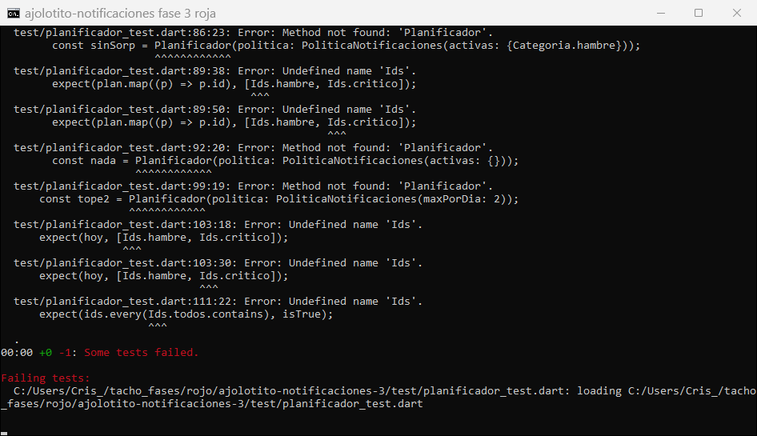

**🟢 Fase verde**

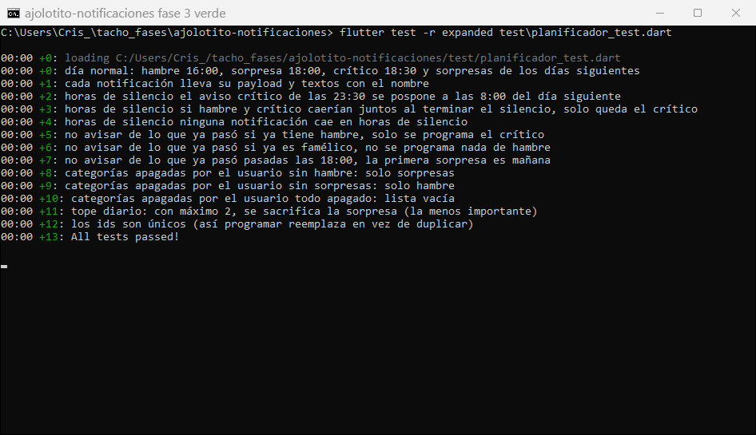

### Fase 4. El permiso, pedido con inteligencia (`test/permiso_test.dart`)

Tres estados (sin preguntar, concedido, denegado): consultar no muestra el diálogo, se pide una sola vez y si dice que no se le guía a Ajustes.

**🔴 Fase roja**

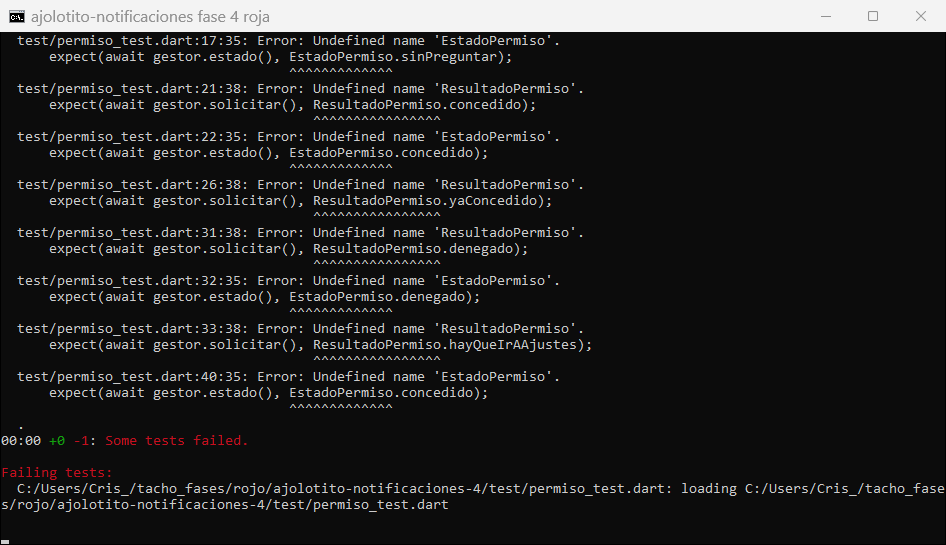

**🟢 Fase verde**

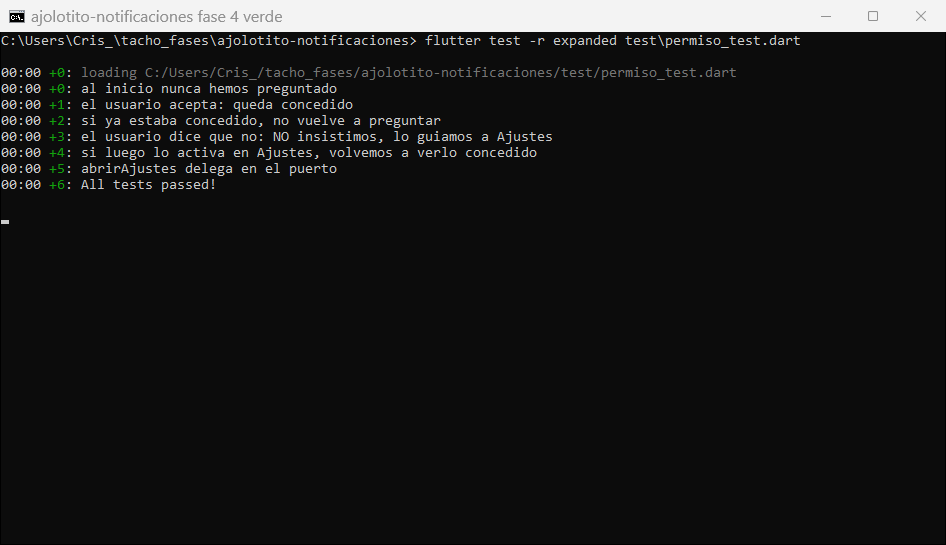

### Fase 5. El servicio que mantiene todo sincronizado (`test/servicio_test.dart`)

`sincronizar` cancela y vuelve a programar: idempotente, sin permiso no programa nada, alimentar reemplaza el aviso viejo, primer/segundo plano, preferencias, modo clase y toques en notificaciones.

**🔴 Fase roja**

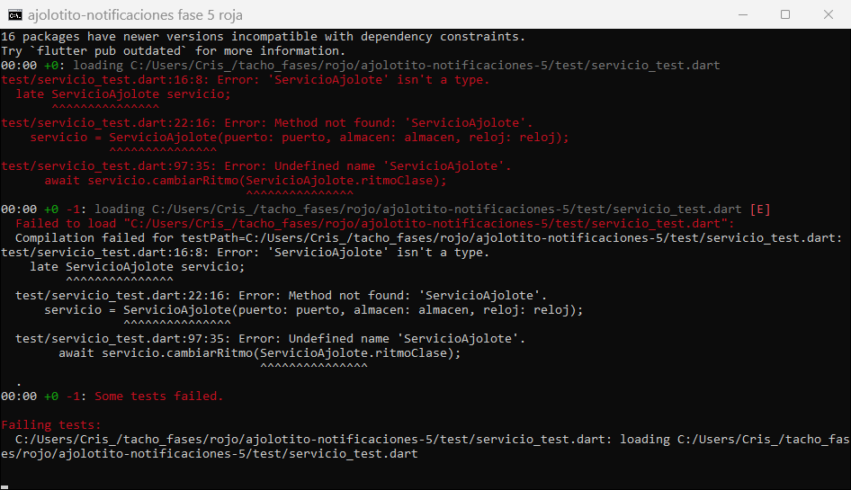

**🟢 Fase verde**

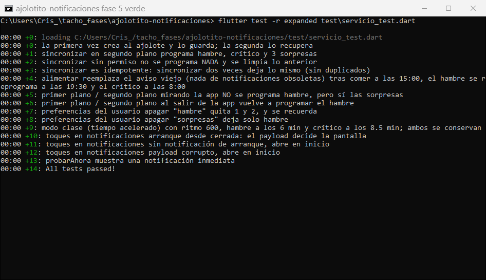

### Fase 6. El ViewModel (`test/vm_test.dart`)

No pide permiso al arrancar, lo pide en contexto, la panza llena avisa con cariño, el botón "Dar de comer" de la notificación alimenta y el ciclo de vida programa/quita el aviso de hambre.

**🔴 Fase roja**

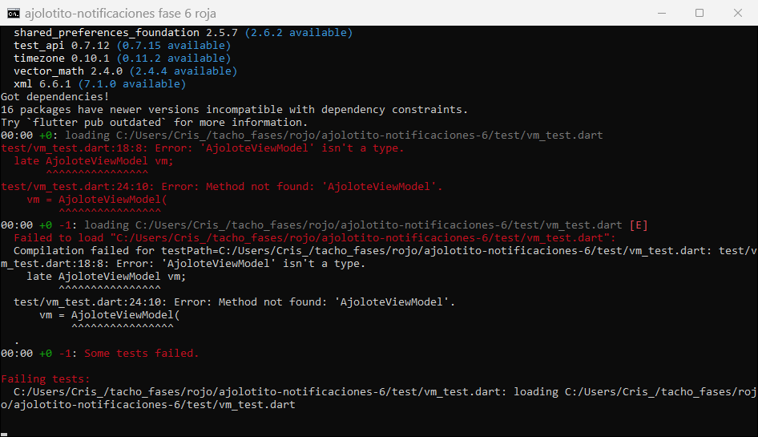

**🟢 Fase verde**

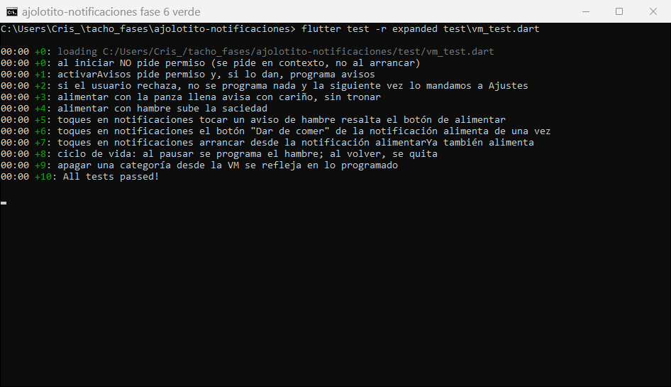

### Fase 7. Todas las pruebas juntas (incluye las de la pantalla)

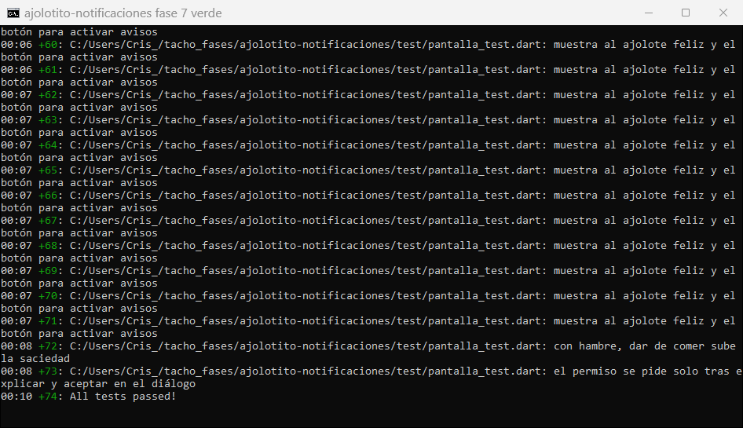

---

## App corriendo en el emulador

<!-- APP_INICIO -->
Capturas tomadas en el emulador de Android con `flutter drive` (prueba de integraci&oacute;n `integration_test/capturas_test.dart`, que recorre la app y toma una foto de cada pantalla).

**La app abierta en el emulador**


| | | |
|:-:|:-:|:-:|
| 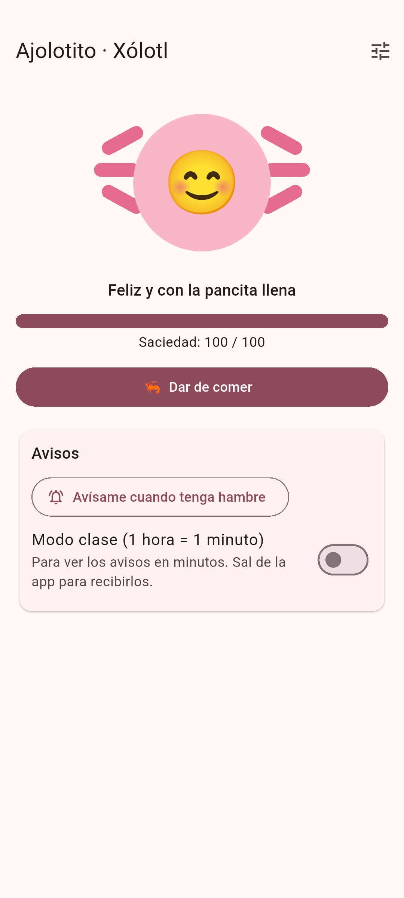<br>Ajolote en la app | 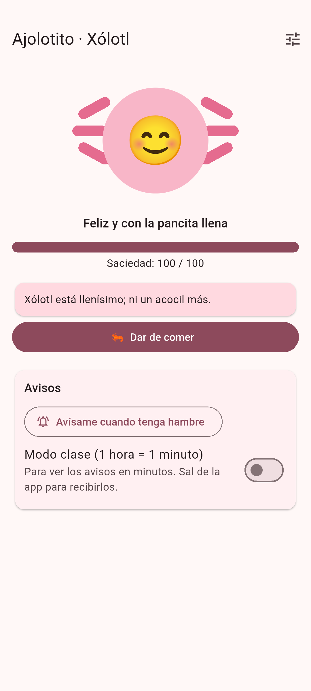<br>Dar de comer | <br>Explicacion antes del permiso |
| <br>Ajustes de avisos |   |   |

**La prueba de integraci&oacute;n ejecutada desde el cmd**

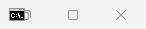

<!-- APP_FIN -->

---

## Configuración de Android

El script agrega al `AndroidManifest.xml` los permisos `POST_NOTIFICATIONS` y `RECEIVE_BOOT_COMPLETED` con los receptores del plugin, y activa el *desugaring* en `android/app/build.gradle.kts`. Las notificaciones se programan como `inexactAllowWhileIdle`, así que no necesitan el permiso de alarmas exactas.

